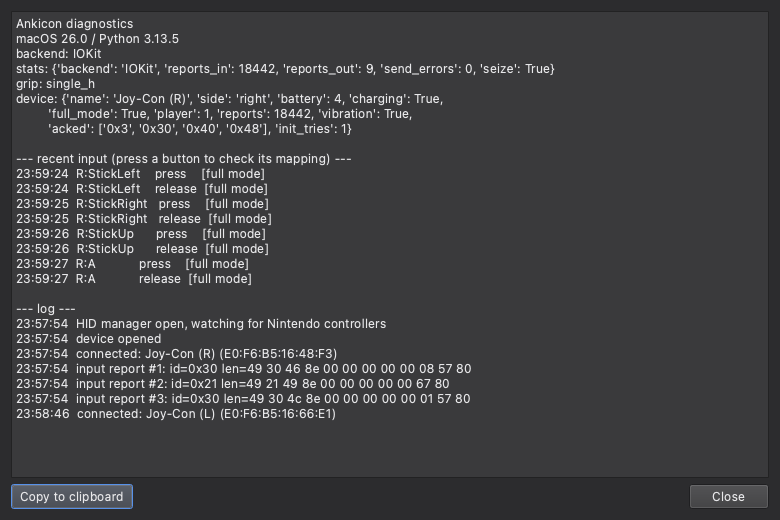

<p align="center">
  
</p>

<p align="center">
  <b>Review Anki with Nintendo Joy-Cons.</b>
</p>

<p align="center">
  
  
  
  
</p>

Show Answer, Again/Hard/Good/Easy, and every command in the reviewer's **More**
menu can be mapped to any button — from a diagram of the controllers themselves.

<p align="center">
  
</p>

No dependencies, no build step, no compiled helper — pure Python talking to
IOKit through `ctypes`.

---

## Contents

- [Features](#features)
- [Versions](#versions)
- [Compatibility](#compatibility)
- [Requirements](#requirements)
- [Installation](#installation)
- [Pairing](#pairing)
- [Mapping buttons](#mapping-buttons)
- [Grips](#grips)
- [Default mapping](#default-mapping)
- [Profiles](#profiles)
- [Options](#options)
- [Architecture](#architecture)
- [Diagnostics](#diagnostics)
- [Troubleshooting](#troubleshooting)
- [Building](#building)
- [Roadmap](#roadmap)
- [Licence](#licence)

---

## Features

- **Every input is bindable** — face buttons, D-pad, both sticks (click plus all
  four directions), `L`/`ZL`, `R`/`ZR`, the `SL`/`SR` rail buttons, `+`/`−`,
  Home and Capture.
- **One or two Joy-Cons.** Each half pairs as its own Bluetooth device, so they
  work alone or together.
- **A separate mapping per grip** — how you hold the hardware decides what your
  fingers can reach.
- **Recolour anything**, shells and individual buttons, from a colour wheel.
- **Save and load profiles** as files you can back up or share.
- **Live feedback** — press a button on a connected Joy-Con and it lights up in
  the window, so you can always see what you are about to bind.

---

## Versions

Ankicon follows [semantic versioning](https://semver.org): `MAJOR.MINOR.PATCH`.
The shipped version is defined once in [`build.py`](build.py) and written into
`manifest.json` at build time.

| Version | Date | Anki | Status | Summary |
|---|---|---|---|---|
| **1.0.0** | 2026-09-08 | 2.1.50+ | **Current** | First public release. Joy-Con support on macOS with per-grip mappings, the full reviewer action set, colour customisation and profiles. |

### 1.0.0 — 2026-09-08

*First public release.*

**Added**

- **Joy-Con support on macOS.** Native `IOHIDManager` backend driven through
  `ctypes` — no dependencies, no build step, no compiled helper. Joy-Con (L) and
  Joy-Con (R) work singly or as a pair, each pairing as its own Bluetooth device.
- **Full button mapping from a diagram of the controllers.** Every input is
  bindable: face buttons, D-pad, both sticks (click plus four directions),
  `L`/`ZL`, `R`/`ZR`, the `SL`/`SR` rail buttons, `+`/`−`, Home and Capture.
- **Three independent per-grip mappings** — Dual-Controller Grip, Horizontal and
  Handheld (Vertical) — selected automatically from what is connected.
- **The complete reviewer action set.** Show Answer, Again/Hard/Good/Easy, and
  every command in the **More** menu: Flags 1–7, Mark, Bury, Suspend, Delete,
  Create Copy, Reset Card, Set Due Date, Card Info, Deck Options, Auto Advance,
  audio replay/pause/seek, Record and Replay Own Voice, Edit and Undo — plus
  navigation (Deck list, Add, Browse, Stats, Sync).
- **Colour customisation** for both shells and every individual button.
- **Profiles** — bindings, colours and orientation saved as JSON files under
  `user_files/`, with import and export.
- **Live button feedback** in the mapping window, so you can see what you are
  about to bind.
- **Rumble on answer**, configurable player LEDs, and an adjustable stick
  deadzone.
- **Diagnostics window** showing live device state, the HID conversation log and
  the raw button ids received.
- **Exclusive-device mode**, for when macOS's own driver holds the controller.

**Known limitations**

- The Pro Controller (Switch 1) is matched by product id but **untested**, and is
  still drawn as a pair of Joy-Cons.
- The bundled `hidapi` backend for Windows and Linux is **unverified**.
- Switch 2 controllers are **not supported**. See [Compatibility](#compatibility)
  and [Roadmap](#roadmap).

---

## Compatibility

| | Status | Notes |
|---|---|---|
| **macOS** | ✅ Supported | The tested platform. Native IOKit backend, no dependencies. |
| **Joy-Con (L) / Joy-Con (R)** | ✅ Supported | Singly or as a pair. |
| **Pro Controller (Switch 1)** | ⚠️ Untested | The product id is matched and the protocol is the same family, so it should map as both halves at once — but nobody has confirmed it, and the diagram still draws a pair of Joy-Cons. Reports welcome. |
| **Windows / Linux** | ⚠️ Unverified | A best-effort `hidapi` backend ships in the add-on and is selected automatically if the `hid` module is importable, but it is untested and the exclusive-access handling is macOS-specific. Not documented as a supported install. |
| **Switch 2 controllers** | ❌ Not supported | Different pairing and report protocol. See [Roadmap](#roadmap). |

---

## Requirements

- macOS
- Anki 2.1.50 or newer
- One or two Joy-Cons paired over Bluetooth

## Installation

Install `ankicon.ankiaddon` with **Tools ▸ Add-ons ▸ Install from file…**, or
copy the `ankicon` folder into `~/Library/Application Support/Anki2/addons21/`.
Restart Anki afterwards.

---

## Pairing

Ankicon connects to Joy-Cons macOS has already paired; it cannot run the
Bluetooth pairing itself, since that lives in System Settings.

1. Detach the Joy-Con from the Switch or its grip.
2. Hold the small round **SYNC** button on the flat inner rail for ~3 seconds,
   until the four player lights run back and forth.
3. **System Settings ▸ Bluetooth** → connect *Joy-Con (L)* or *Joy-Con (R)*.
4. In Anki, **Tools ▸ Ankicon…** → **Rescan**.
5. Repeat for the second Joy-Con.

When a controller is live its player LED lights steadily and the status bar
turns green. If macOS asks for Input Monitoring permission, grant it to Anki in
**System Settings ▸ Privacy & Security**, then restart Anki.

---

## Mapping buttons

Open **Tools ▸ Ankicon…**. Every input on the diagram has a leader line to its
own dropdown.

| Gesture | Effect |
|---|---|
| **Click** a button on the diagram | Jumps to that button's dropdown |
| **Right-click** a button, or use the colour chip beside its dropdown | Recolours it — the two chips in the toolbar recolour the shells |
| **Press** a button on a live Joy-Con | It flashes in the window, confirming which physical button you are editing |

Bindable actions cover the whole **More** menu: Flag 1–7, Mark Note, Bury Card,
Bury Note, Suspend Card, Suspend Note, Delete Note, Create Copy, Reset Card, Set
Due Date, Card Info, Previous Card Info, Deck Options, Auto Advance,
Replay/Pause/Seek audio, Record and Replay Own Voice, Edit and Undo — plus
navigation (Deck list, Add, Browse, Stats, Sync).

---

## Grips

Each grip keeps its **own complete mapping**, and the window follows whatever is
connected.

| Grip | When it's live | What changes |
|---|---|---|
| **Dual-Controller Grip** | Both halves connected | Every button reachable. `SL`/`SR` default to unbound — a grip covers them. |
| **Horizontal** | One Joy-Con, held sideways | `SL`/`SR` become the shoulders, so they take Show Answer and Undo. |
| **Handheld (Vertical)** | One Joy-Con, held upright | `L`/`R` are back under your index finger and take Show Answer. |

With both halves connected the window locks to the dual map. With one, the half
that isn't connected is greyed out and you choose the orientation. With nothing
connected all three are editable, so you can set up your mapping before the
hardware is on the desk.

A single Joy-Con is drawn rotated the way you'd actually be holding it, and its
callouts spread across both sides of the window:

| Handheld (Vertical) | Horizontal |
|---|---|
|  |  |

---

## Default mapping

Face buttons and the D-pad mean the same thing in every grip, so muscle memory
for Again/Hard/Good/Easy doesn't move around:

| Right Joy-Con | Action | Left Joy-Con | Action |
|---|---|---|---|
| `A` | Good | `▶` Right | Good |
| `B` | Again | `▼` Down | Again |
| `X` | Easy | `▲` Up | Easy |
| `Y` | Hard | `◀` Left | Hard |
| `+` Plus | Open the More menu | `−` Minus | Open the More menu |
| Home | Toggle Auto Advance | Capture | Mark Note |
| Stick click | Mark Note | Stick click | Flag 1 |
| Stick `◀` `▶` | Audio −5s / +5s | Stick `◀` `▶` | Audio −5s / +5s |
| Stick `▲` `▼` | Replay Audio / Bury Card | Stick `▲` `▼` | Replay Audio / Bury Card |

What varies per grip is the shoulders and the rail:

| Input | Dual-Controller Grip | Horizontal | Handheld (Vertical) |
|---|---|---|---|
| `L` / `R` | Undo / Show Answer | Replay Audio | Show Answer |
| `ZL` / `ZR` | Pause Audio / Replay Audio | Pause Audio | Replay Audio |
| `SL` / `SR` | *unbound* — a grip covers them | Undo / Show Answer | Audio −5s / +5s |

---

## Profiles

**Save as…** writes the current bindings, colours and orientation to a JSON file
in the add-on's `user_files/profiles/` directory, which Anki preserves across
add-on updates. Pick a profile from the dropdown to load it; **Import…** and
**Export…** move them between machines.

Profiles cover the controller only. Rumble strength, deadzone and logging live
in **Options…** and aren't touched when you load one.

---

## Options

| Option | What it does |
|---|---|
| **Listen for Joy-Cons** | The master switch. |
| **Take exclusive control of the controller** | Takes the Joy-Con away from macOS's own driver. Turn this on if buttons do nothing. |
| **An ease button on the question side shows the answer instead** | So a press is never swallowed. |
| **Rumble on answer** *and* strength | Haptic confirmation when a card is answered. |
| **Stick deadzone** | How far the stick must move to count. |
| **Tooltip naming each action**, **verbose logging** | Debugging aids. |

---

## Architecture


| Module | Responsibility |
|---|---|
| [`__init__.py`](__init__.py) | Add-on entry point: installs the **Tools ▸ Ankicon…** menu item and wires profile/quit hooks. |
| [`controller.py`](controller.py) | The thread boundary. Turns button edges into actions on Anki's main thread. |
| [`actions.py`](actions.py) | The catalogue of bindable commands and how each one is invoked. |
| [`settings.py`](settings.py) | Config schema, per-grip layouts, defaults, migration. |
| [`profiles.py`](profiles.py) | Named binding/colour bundles as JSON files under `user_files/`. |
| [`dialog.py`](dialog.py) | The mapping window, Options and Diagnostics dialogs. |
| [`joycon_view.py`](joycon_view.py) | The exploded parts-diagram panel. |
| [`art.py`](art.py) | Controller geometry in local coordinates — no bundled images. |
| [`joycon/`](joycon/) | Hardware library: protocol, backends, per-device state, hub. Qt-free. |

### How it works

**Talking to the hardware.** [`joycon/backend_macos.py`](joycon/backend_macos.py)
opens an `IOHIDManager` through `ctypes`, matches on Nintendo's vendor id, and
pumps input reports on a `CFRunLoop`. Doing it in `ctypes` rather than shipping
a compiled helper matters here: Anki add-ons have to be pure Python, and there
is nowhere to put a `.dylib` that every user's Anki build would load. Reports
arrive on a background thread and cross to Qt over a queued signal, because the
collection may only be touched on the main thread.

**Pacing the handshake.** A Joy-Con processes one subcommand at a time and
silently drops anything that lands while it is busy, so the four setup
subcommands are spaced ~90 ms apart and each is re-sent until the controller
acknowledges it in a `0x21` reply. Sending them back-to-back appears to work,
but which ones survive is a race: lose `0x48` and rumble is dead, lose `0x03`
and the controller stays in its sideways-gamepad report mode.

**Two report formats.** Full mode (`0x30`, 60 Hz) gives analog sticks and
battery level. If it never engages, the default `0x3F` report still drives the
buttons — but in that mode the Joy-Con pretends to be a small gamepad held
*sideways*, so the D-pad and stick arrive rotated and have to be turned back to
the labels printed on the plastic.

**Stick centring.** Factory calibration lives in the controller's SPI flash and
drifts unit to unit, so instead of reading it Ankicon averages the first ~20
samples at rest and measures deflection from there, with hysteresis so a stick
resting near the threshold doesn't machine-gun the reviewer.

**How actions fire.** Rather than calling reviewer internals (which Anki renames
between releases), each action first tries to emit the `QShortcut` Anki itself
registered for that key, then a matching menu `QAction`, then falls back to
direct method calls under several historical names. A binding keeps working
across upgrades, and whatever Anki does for `2` today is exactly what the
Joy-Con does.

**Drawing the controllers.** The artwork is plain `QPainter` geometry
([`art.py`](art.py)), not bundled images: it stays crisp at any size and DPI,
every button recolours by changing one fill, and hit-testing a click is a
distance check in local coordinates. The callout rows are real `QComboBox`
widgets positioned by hand, with the leader lines drawn underneath them.
Rotating for the Horizontal grip is one `QTransform` that the anchor points ride
along with, which is why the stick arrows keep pointing the right way.

**Guard rails.** Review-only actions do nothing outside the reviewer, nothing
fires while a modal dialog is open, and an ease press on the question side
reveals the answer instead of being swallowed.

---

## Diagnostics

**Diagnostics…** shows live device state, a log of the HID conversation, and a
running list of the button ids the add-on actually received. If a button does
the wrong thing, press it here — that distinguishes a wrong binding from a
mis-parsed report.



---

## Troubleshooting

**Nothing is detected.** Confirm the Joy-Con shows as *Connected* in System
Settings ▸ Bluetooth, then press **Rescan**. Joy-Cons drop the link when idle;
press any button on the controller to wake it.

**Detected, but no buttons work.** The status bar turns amber and says the
controller is "connected but sending nothing" when the device is paired but not
one HID report is arriving. That is almost always macOS's own Joy-Con driver
holding it. Open **Options…**, tick **Take exclusive control of the
controller**, and it re-opens the device by itself.

If that doesn't do it, **Diagnostics…** shows the decoded `IOReturn` from the
HID open. `kIOReturnNotPermitted` means Input Monitoring is still off for Anki;
`kIOReturnExclusiveAccess` means another process has the controller.

**Says "still negotiating".** The controller hasn't finished the handshake that
switches it to 60 Hz reports and enables the motor. Ankicon keeps retrying the
parts that were never acknowledged, so this normally clears itself in a second
or two.

**A button does the wrong thing.** Open **Diagnostics…** and press it. The
*recent input* section lists the button id received and whether the controller
is in full or basic mode.

**Sticks are drifty.** Raise the deadzone in **Options…**, or reconnect the
controller with the stick at rest so auto-centring samples a clean position.

---

## Building

```sh
python3 build.py
```

Regenerates `config.json` from `settings.defaults()`, writes `manifest.json`,
and zips `ankicon.ankiaddon` — so the shipped defaults can't drift from the
code.

---

## Roadmap

- **Verify the Pro Controller (Switch 1).** The add-on already matches its
  product id; it needs testing and its own artwork rather than being
  approximated by two Joy-Con halves.
- **Verify Windows and Linux** through the bundled `hidapi` backend, and work
  out the equivalent of macOS's exclusive-access handling on each.
- **Switch 2 controllers**, including the Switch 2 Pro Controller — new device
  ids, a new report parser and new artwork.
- **Artwork per controller type.**

---

## Licence

[MIT](LICENSE) © 2026 Jagaller
