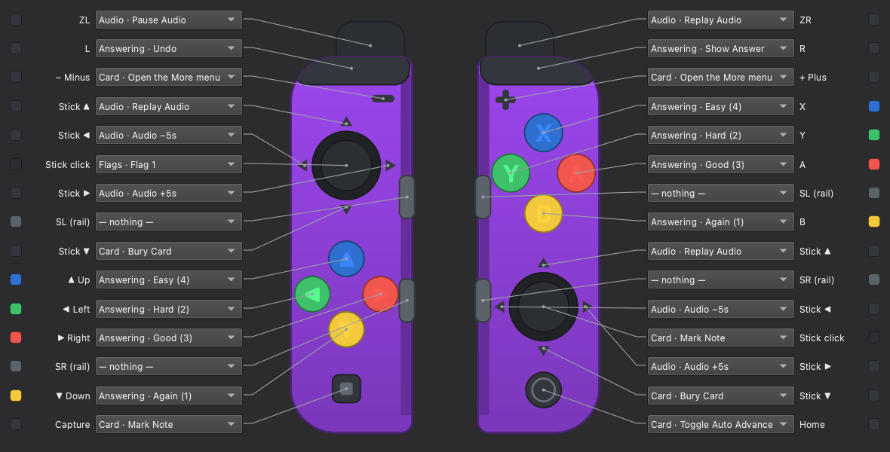
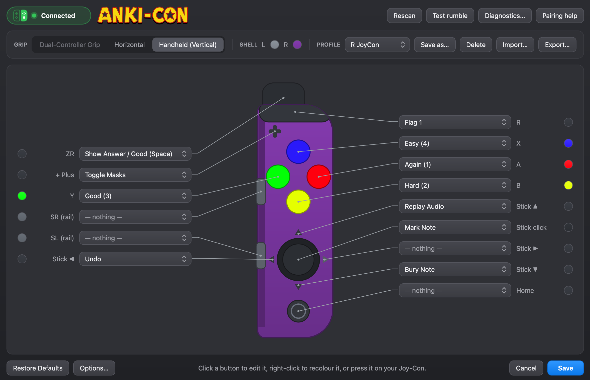
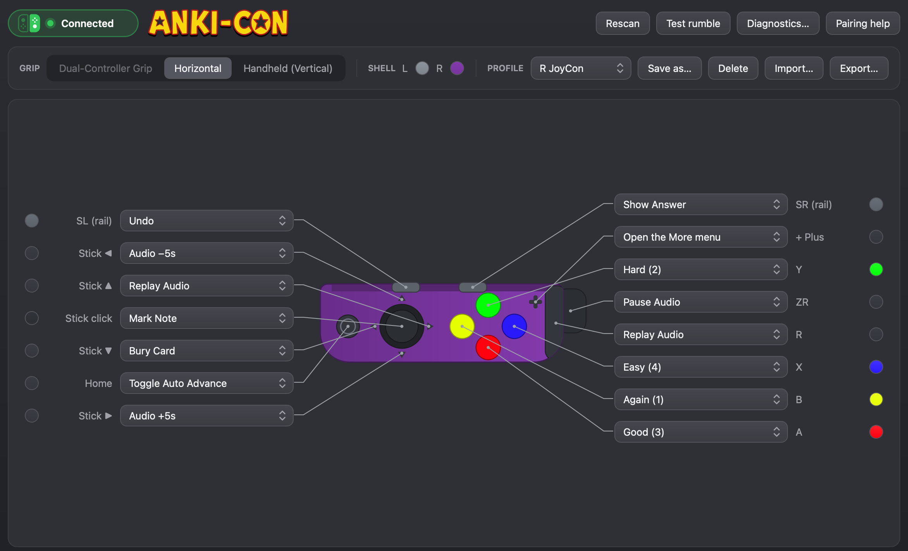
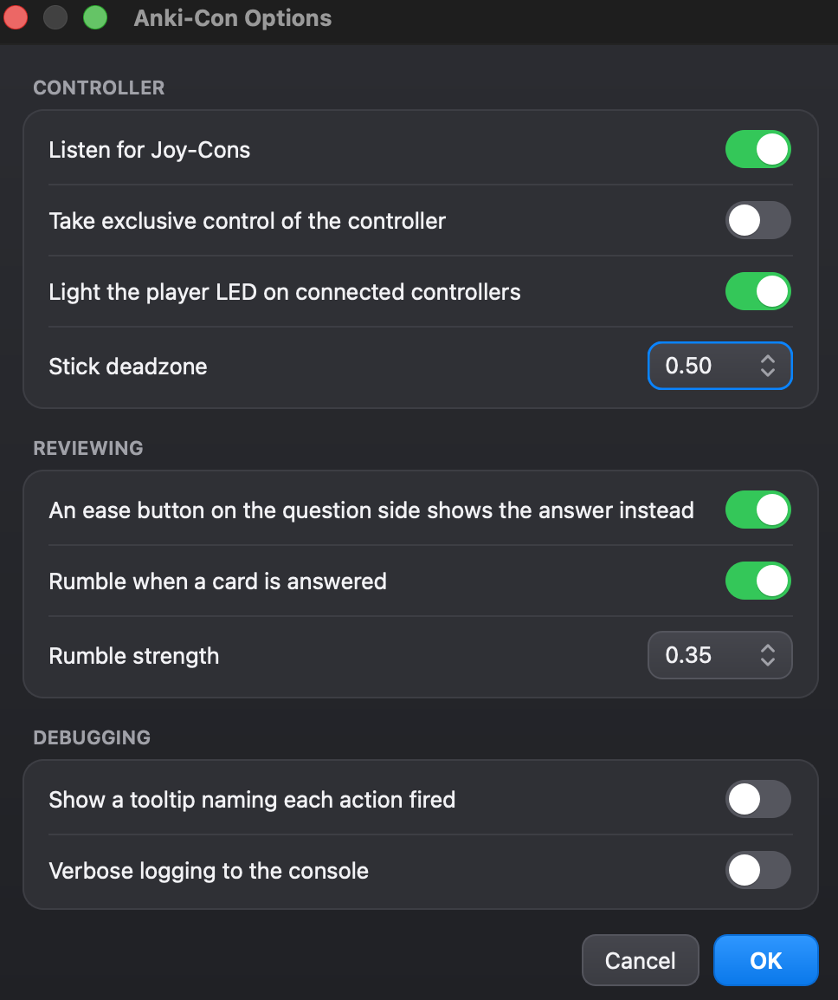
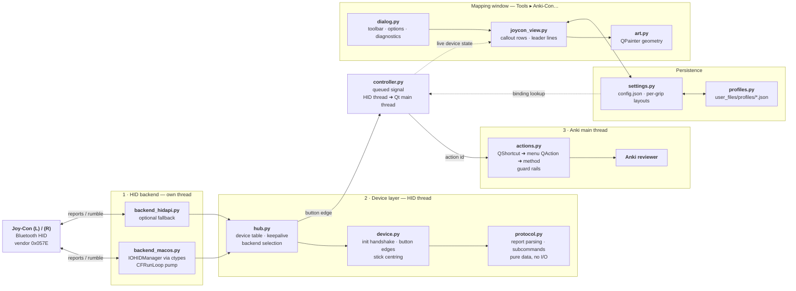

<p align="center">
  
</p>

<p align="center">
  <b>Review Anki with Nintendo Joy-Cons.</b>
</p>

<p align="center">
  
  
  
  
</p>

Anki-Con lets you review your cards from a controller. Pick a button on the
diagram, choose what it does, and start studying.

<p align="center">
  
</p>

## Contents

- [Features](#features)
- [Compatibility](#compatibility)
- [Getting started](#getting-started)
- [Mapping buttons](#mapping-buttons)
- [Grips](#grips)
- [Default mapping](#default-mapping)
- [Profiles](#profiles)
- [Options](#options)
- [Troubleshooting](#troubleshooting)
- [How it works](#how-it-works)
- [Building](#building)
- [Roadmap](#roadmap)
- [Versions](#versions)
- [Licence](#licence)

## Features

- Map every button, trigger and stick direction, including the `SL`/`SR` rail
  buttons, Home and Capture.
- Use one Joy-Con or two.
- Keep a separate mapping for each way you hold them.
- Recolour the shells and buttons.
- Save your setup as a profile to back up or share.
- Press a button on your Joy-Con and watch it light up in the window.

Nothing else to install: it's pure Python that talks to macOS directly.

## Compatibility

| | Status | Notes |
|---|---|---|
| **Anki 26.09.4** | ✅ Supported | The tested release. Also installs on 2.1.50 and later, untested. |
| **macOS** | ✅ Supported | The only tested platform. |
| **Joy-Con (L) / (R)** | ✅ Supported | One or both. |
| **Pro Controller (Switch 1)** | ⚠️ Untested | Should work, but is drawn as a pair of Joy-Cons. Reports welcome. |
| **Windows / Linux** | ⚠️ Unverified | Falls back to `hidapi` if Python's `hid` module is available. |
| **Switch 2 controllers** | ❌ Not supported | They use a different protocol. |

## Getting started

### Install

In Anki, go to **Tools ▸ Add-ons ▸ Install from file…**, choose
`ankicon.ankiaddon`, then restart Anki.

### Pair

1. Detach the Joy-Con from the Switch or its grip.
2. Hold the small round **SYNC** button on the inner rail for about three
   seconds, until the player lights run back and forth.
3. Connect *Joy-Con (L)* or *Joy-Con (R)* in **System Settings ▸ Bluetooth**.
4. In Anki, open **Tools ▸ Anki-Con…** and press **Rescan**.
5. Do the same for the second Joy-Con, if you have one.

The indicator turns green when your Joy-Con is connected. If macOS asks for Input
Monitoring permission, allow it for Anki in **System Settings ▸ Privacy &
Security** and restart Anki.

## Mapping buttons

Open **Tools ▸ Anki-Con…** and choose an action from the dropdown beside any
button. Press **Save** when you're done.

- **Click** a button on the diagram to jump to its dropdown.
- **Right-click** it, or use the colour dot on its row, to recolour it. The two
  **Shell** dots in the toolbar recolour the Joy-Cons.
- **Press** a button on your Joy-Con and it lights up green.

You can map:

- **Answering:** Show Answer, Again, Hard, Good, Easy and Undo
- **Cards and notes:** Toggle Masks, Mark, Bury, Suspend, Delete, Create Copy,
  Reset, Set Due Date, Edit, Card Info, Previous Card Info, Deck Options, Auto
  Advance, and the **More** menu itself
- **Flags:** 1–7
- **Audio:** replay, pause, skip back or forward, record and replay your voice
- **Navigation:** Deck list, Study current deck, Add, Browse, Statistics and Sync

**Toggle Masks** works on cards made with Anki's Image Occlusion or the Image
Occlusion Enhanced add-on. It isn't mapped by default.

## Grips

Each grip has its own mapping, and Anki-Con picks one based on what's connected.

| Grip | When it's used | Good to know |
|---|---|---|
| **Dual-Controller Grip** | Both Joy-Cons connected | `SL`/`SR` start unmapped, since a grip covers them. |
| **Horizontal** | One Joy-Con, held sideways | `SL`/`SR` become the shoulder buttons. |
| **Handheld (Vertical)** | One Joy-Con, held upright | `L`/`R` sit under your index finger. |

With one Joy-Con connected, you choose Horizontal or Handheld. With none, you
can edit all three.

| Handheld (Vertical) | Horizontal |
|---|---|
|  |  |

## Default mapping

These are the same in every grip:

| Right Joy-Con | Left Joy-Con | Action |
|---|---|---|
| `B` | `▼` | Again |
| `Y` | `◀` | Hard |
| `A` | `▶` | Good |
| `X` | `▲` | Easy |
| `+` | `−` | Open the More menu |
| Stick `◀` / `▶` | Stick `◀` / `▶` | Audio −5s / +5s |
| Stick `▲` / `▼` | Stick `▲` / `▼` | Replay Audio / Bury Card |
| Stick click | Capture | Mark Note |
| Home | | Toggle Auto Advance |
| | Stick click | Flag 1 |

The shoulder and rail buttons depend on the grip:

| Input | Dual-Controller Grip | Horizontal | Handheld (Vertical) |
|---|---|---|---|
| `L` / `R` | Undo / Show Answer | Replay Audio (both) | Show Answer (both) |
| `ZL` / `ZR` | Pause Audio / Replay Audio | Pause Audio (both) | Replay Audio (both) |
| `SL` / `SR` | Unmapped | Undo / Show Answer | Audio −5s / +5s |

> `SL` is the upper rail button on the left Joy-Con and the lower one on the
> right. Held sideways, it's under your left index finger on either.

## Profiles

**Save as…** stores your mappings, colours and orientation. Use the dropdown to
switch profiles, and **Import…** and **Export…** to move them between computers.
They survive add-on updates. Settings under **Options…** aren't included.

## Options

Press **Options…** at the bottom of the window. Click the **?** beside a setting
to see what it does.

<p align="center">
  
</p>

| Option | What it does |
|---|---|
| **Enable Joy-Cons** | Lets Anki-Con respond to your Joy-Cons. |
| **Exclusive control** | Stops macOS from using the Joy-Con while Anki has it. Try this if buttons do nothing. |
| **Player LED** | Lights the player number on each Joy-Con. |
| **Stick deadzone** | How far you push the stick before it counts. |
| **Reveal answer first** | Pressing Again, Hard, Good or Easy shows a hidden answer. When off, the press is ignored. |
| **Rumble** | Vibrates when you answer a card or use a card action, such as Mark or Bury. Off by default. |
| **Rumble strength** | From 0 (none) to 1 (strongest). |
| **Action tooltips** | Briefly shows the name of each action. |
| **Verbose logging** | Prints controller activity to the console. |

Press **Save** in the main window to keep your changes.

## Troubleshooting

**Nothing is detected.** Check that the Joy-Con is connected in System Settings ▸
Bluetooth, press a button to wake it, then press **Rescan**.

**It's connected, but the buttons do nothing.** macOS is probably holding the
controller. Turn on **Exclusive control** in
**Options…**, then save. If that doesn't help, look in **Diagnostics…**:

- `kIOReturnNotPermitted` means Anki needs Input Monitoring permission.
- `kIOReturnExclusiveAccess` means another app has the controller.

**Checking the details.** Hover over the indicator for the battery level, active
grip and connection details. If it says "still negotiating" for more than a few
seconds, press **Rescan**.

**A button does the wrong thing.** Open **Diagnostics…** and press it to see
which button Anki-Con received.

**The stick drifts.** Raise the deadzone in **Options…**, or reconnect without
touching the stick so it can find its centre.

## How it works



- **Connection:** [`backend_macos.py`](joycon/backend_macos.py) reads the
  controllers through IOKit using `ctypes`, so there's no compiled code to ship.
- **Handshake:** Joy-Cons drop commands that arrive while they're busy, so
  Anki-Con spaces them out and resends any that go unanswered.
- **Sticks:** Anki-Con finds each stick's centre from its first readings at rest
  instead of relying on factory calibration.
- **Threads:** controller input arrives on a background thread, and
  [`controller.py`](controller.py) passes it to Anki's main thread.
- **Actions:** [`actions.py`](actions.py) tries Anki's own shortcut first, then a
  menu item, then a direct call, so mappings tend to survive Anki updates.
  Toggle Masks clicks the button on the card.
- **Safety:** review actions only work while reviewing, and nothing fires while a
  modal dialog or menu is open.
- **Artwork:** the controllers are drawn in code ([`art.py`](art.py)), so they
  stay sharp at any size.

## Building

```sh
python3 build.py
```

This regenerates `config.json` and `manifest.json` and packages
`ankicon.ankiaddon`. The version number lives in [`build.py`](build.py).

## Roadmap

- Test the Switch 1 Pro Controller and give it its own artwork.
- Test Windows and Linux.
- Support Switch 2 controllers.

## Versions

Anki-Con uses [semantic versioning](https://semver.org).

| Version | Date | Anki |
|---|---|---|
| **1.1.0** (current) | 2026-11-24 | 26.09.4 |
| 1.0.1 | 2026-09-08 | 26.08.01 |
| 1.0.0 | 2026-09-08 | 26.08.01 |

### 1.1.0

**Added**

- Toggle Masks, for Anki's Image Occlusion and Image Occlusion Enhanced.
- An option for the player LED. The old `player_leds` setting did nothing.

**Changed**

- Now tested on Anki 26.09.4, with Delete Note, Reset Card and Sync updated to
  match.
- The add-on's name in Anki is now Anki-Con.
- A refreshed look for the mapping, Options and Diagnostics windows.
- Rumble is off by default. Your saved setting is kept.
- Shorter option names, each with a **?** that explains it.
- A simple connection indicator replaces the status text. Hover over it for
  details.
- Show Answer only shows the answer. A second press used to grade the card; use
  **Show Answer / Good (Space)** if you want that.

**Fixed**

- Turning Joy-Cons off and on in Options now resumes listening.
- Ease buttons no longer reveal the answer behind an open dialog or menu.
- A stick held on a Joy-Con that disconnects no longer keeps repeating while the
  other stays connected.
- A Joy-Con that connects in basic mode is now asked again until it switches to
  full mode.
- Rumble while reviewing now reaches the controller.
- Importing a profile now loads it straight away.
- Holding a stick on Bury Card or Bury Note now buries once, not about seven
  times a second.

### 1.0.1

**Fixed**

- `SL` and `SR` were swapped on the right Joy-Con in the mapping window.

**Changed**

- Now tested on Anki 26.08.01.

### 1.0.0

First public release: Joy-Con support on macOS, a mapping for each grip, every
reviewer action, custom colours, profiles, rumble, live button feedback,
diagnostics and exclusive control.

## Licence

[MIT](LICENSE) © 2026 Jagaller
